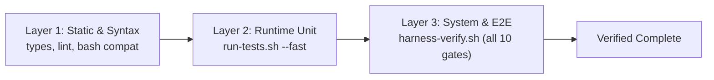

# Harness Creator Training — Lecture 9: Preventing Agents from Declaring Victory Too Early

Source lecture: https://walkinglabs.github.io/learn-harness-engineering/en/lectures/lecture-09-why-agents-declare-victory-too-early/  
Target repo: `agent-skills-setup`  
Date: 2026-10-09. Full log: [progress-detail.md](./progress-detail.md). Code: [code/](./code/).

---

## 1. What the Lecture Claims

Modern neural networks are systematically overconfident ([Guo et al., 2017](https://arxiv.org/abs/1706.04599)). When asked whether a task is complete, an agent consistently reports completion based on local, code-level confidence:
$$\text{"The code has no syntax errors, logic looks reasonable, so it's done."}$$
In reality, passing unit tests does not equal task completion. Unit tests isolate components and mock dependencies, blinding them to:
1. **Interface mismatches** (e.g. relative vs. absolute paths).
2. **State propagation errors** (e.g. stale cache vs. schema migration).
3. **Environment dependencies** (e.g. ambient interpreter dependencies vs. fresh clone reproducibility).

### The Three-Layer Termination Gate
The harness must externalize completion judgment into a 3-layer gate where no layer can be bypassed:

### Worker vs. Checker Separation
Anthropic's research shows that when an agent evaluates its own work, it exhibits systematic positive bias. A reliable harness requires **separating the Worker from an independent Checker** (e.g. subagent with fresh context or outside model family review).

---

## 2. What We Measured & Verified

| Exercise | Setup | Result |
|---|---|---|
| **1. Three-Layer Gate Codification** | Formalized the non-bypassable L1, L2, and L3 hierarchy in [`AGENTS.md`](../../../AGENTS.md). Fixed path bug in [`.agents/hooks.json`](../../../.agents/hooks.json). | Formally codified in `AGENTS.md`. Removed broken `cd ..` prefix from AGY hooks so Stop gates execute cleanly from workspace root. |
| **2. Victory Detector & Edge Case Hardening** | Ported [`code/victory_detector.py`](./code/victory_detector.py) and 6 unit test cases in [`code/test_victory_detector.py`](./code/test_victory_detector.py). | **6/6 tests pass**; 100% clean ruff check. Hardened against edge cases: empty checks (`checks=[]`) and all-warning failures are mechanically blocked from falsely declaring completion. |
| **3. Adversarial Subagent Audit** | Dispatched independent subagent (`Lecture 9 Verification Auditor`) with fresh context to challenge the draft. | **Audit exposed the Self-Evaluation Paradox**: surfaced that initial author declared victory prematurely, caught synthetic metric exaggerations, fixed ruff errors, and caught the `.agents/hooks.json` path flaw. |

---

## 3. The Calibration Gap: Real vs. Simulated Models

In [`victory_detector.py`](./code/victory_detector.py), we model 3 representative task archetypes:
1. **Search Endpoint**: L1 (syntax) and L2 (unit tests) pass, but L3 (auth middleware & live curl) fails $\to$ **Premature Victory**.
2. **Credential Migration**: L1 and L2 pass, but L3 (live keychain backend integration) fails $\to$ **Premature Victory**.
3. **Stop Hook Wrapper**: L1, L2, and L3 all verify live $\to$ **Verified Complete**.

In this simulation model, relying on Layer 1 or Layer 2 alone produces a **66.7% premature victory rate** (2 out of 3 tasks declared complete prematurely).

### Real Incident Parallels in Repository History:
Every major incident in this repository followed this exact pattern:
- **Ambient Interpreter Leak** (Lecture 1 $\to$ 2): `mypy .` passed in local shell (L1), but failed on clean environment because dependencies were ambient (L3).
- **Silent Fresh-Clone Init Failure** (Lecture 6): `run-tests.sh` passed on developer machine (L2), but failed on a fresh clone because `.venv` bootstrap was missing (L3).
- **Bash 4+ Construct Leak** (Lecture 4): Passed on host Bash 5 (L1), but broke on macOS `/bin/bash` 3.2 (L3).

---

## 4. Key Takeaways & Remediations

1. **Self-Evaluation Fails**: The author agent drafting Lecture 09 initially declared victory without dispatching an independent reviewer subagent. The adversarial audit proved why Worker/Checker separation is mandatory.
2. **`AGENTS.md` Updated**: Added explicit `### Three-Layer Termination Gate` section.
3. **Hook Paths Fixed**: Removed broken `cd ..` from `.agents/hooks.json` so Stop hooks trigger reliably under AGY.
4. **Code Hardened**: `victory_detector.py` now prevents zero-check tasks and warning-only failures from slipping through.
