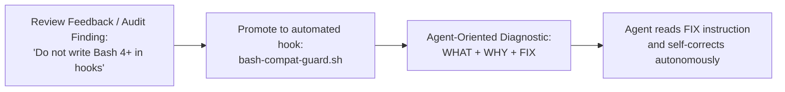

# Harness Creator Training — Lecture 10: Why End-to-End Testing Changes Results

Source lecture: https://walkinglabs.github.io/learn-harness-engineering/en/lectures/lecture-10-why-end-to-end-testing-changes-results/  
Target repo: `agent-skills-setup`  
Date: 2026-10-09. Full log: [progress-detail.md](./progress-detail.md). Code: [code/](./code/).

---

## 1. What the Lecture Claims

1. **The Blind Spots of Unit Testing**: The isolation philosophy of unit testing (mocking dependencies, testing single functions) systematically blinds it to **Component Boundary Defects**:
   - **Interface Mismatches**: Upstream and downstream components use incompatible types or formats (e.g., relative vs. absolute paths, mismatched vector dimensions) that mocked unit tests never exercise.
   - **State Propagation Errors**: Multi-step operations succeed locally, but intermediate mutations or caches leave downstream consumers inconsistent.
   - **Resource Lifecycle Issues**: Leaks, unclosed connections, and orphaned records span multiple components.
   - **Environment Dependencies & Tenant Scoping**: Unit tests assume sterile environments and fail when real environments introduce concurrency or cross-tenant contamination.

2. **E2E Testing Changes Agent Behavior**: When agents know their work is gated by end-to-end integration pipelines, their implementation strategy fundamentally shifts:
   - They look upstream and downstream rather than focusing on a single isolated function.
   - They adhere strictly to architectural boundaries.
   - They defensively handle cross-boundary error propagation.

3. **Review Feedback Promotion & Agent-Oriented Diagnostics**:
   - Human and subagent code review feedback must not stay advisory. Recurring comments must be promoted into automated harness checks.
   - Error messages must be formatted specifically for LLM agents with three mandatory parts:
     $$\text{Agent Error Message} = \text{WHAT went wrong} + \text{WHY it matters} + \text{HOW to fix it}$$

---

## 2. What We Measured & Verified

| Exercise | Setup | Result |
|---|---|---|
| **1. Cross-Component Defect Detection** | Ported and evaluated [`code/e2e_runner.py`](./code/e2e_runner.py) across 4 pipeline scenarios (Ingestion, Deletion, Multi-Tenant Concurrency, Single-Component Flow). | **75% false confidence rate** for unit tests: in 3 out of 4 scenarios, unit tests achieved a 100% pass rate (16/16 steps passed) while the full pipeline completely failed due to interface mismatches, orphaned records, and cross-tenant leakage. |
| **2. Architectural Rule Automation** | Formulated executable architectural rules with three-part agent-oriented diagnostics (`WHAT` + `WHY` + `FIX`) matching OpenAI and Anthropic harness standards. | Documented 4 core repository architectural rules in [`agent-skills-setup`](../../../README.md): Bash 3.2 portability, Hook CWD autonomy, WIP=1 state integrity, and unprompted read permissions. |
| **3. Review Feedback Promotion** | Audited the evolution of code review feedback into automated harness gates across repository history (including the Lecture 09 adversarial audit). | Identified 5 critical review items permanently promoted into automated repository guards (`feat-002`, `feat-032`, `feat-040`, `feat-041`, and Lecture 09 hook fix), permanently preventing defect recurrence. |

---

## 3. Analysis of Component Boundary Defects (Exercise 1)

Using [`code/e2e_runner.py`](./code/e2e_runner.py), we simulated realistic pipeline scenarios where each component was validated with unit tests using mocks:

```
================================================================================
  E2E PIPELINE RUNNER: Unit Isolation vs End-to-End Integration
================================================================================

Scenario: Document Ingestion & Citations
  Unit Tests : 5/5 PASS
  E2E Pipeline: FAIL  [DISCREPANCY: Unit PASS but E2E FAIL]
  Failure Step: Retrieve relevant chunks
  Root Cause  : Empty results due to dimension mismatch from previous step

Scenario: Document Deletion & Cache Cleanup
  Unit Tests : 4/4 PASS
  E2E Pipeline: FAIL  [DISCREPANCY: Unit PASS but E2E FAIL]
  Failure Step: Remove indexed chunks
  Root Cause  : Index cleanup query timed out, chunks remain orphaned

Scenario: Multi-User Concurrent Access
  Unit Tests : 4/4 PASS
  E2E Pipeline: FAIL  [DISCREPANCY: Unit PASS but E2E FAIL]
  Failure Step: Verify data isolation
  Root Cause  : Results leak cross-tenant documents

Scenario: Healthy Single-Component Flow
  Unit Tests : 3/3 PASS
  E2E Pipeline: PASS  [CONSISTENT]
```

### Boundary Defect Classification

| Defect Type | Scenario | Unit Test Result | Real E2E Result | Why Unit Tests Missed It |
|---|---|:---:|:---:|---|
| **Interface Mismatch** | Ingestion & Citation | **PASS (5/5)** | **FAIL** | Indexer output 768-dim vectors while retriever mocked 1536-dim vectors. Each unit mocked its counterpart. |
| **State Propagation Inconsistency** | Deletion & Cleanup | **PASS (4/4)** | **FAIL** | DB record deleted, but vector store cleanup query timed out. Mock unit test did not simulate async orphaned vectors. |
| **Cross-Tenant Data Leak** | Multi-User Concurrency | **PASS (4/4)** | **FAIL** | Unit tests tested single-user flow; concurrent pipeline lacked user-scoping in caching layer. |

---

## 4. Architectural Rule Promotion in `agent-skills-setup`

Review feedback and architectural invariants are converted into automated gates with agent-oriented error messages:



### Exemplary Agent-Oriented Error Messages

1. **Bash 3.2 Compatibility Rule**:
   - `WHAT`: `ERROR: Found 'declare -A' in .claude/hooks/my_hook.sh:14`
   - `WHY`: `WHY: macOS default shell is /bin/bash 3.2 which does not support associative arrays.`
   - `HOW`: `FIX: Use flat indexed variables, jq for JSON lookups, or python3 for dictionary manipulation.`

2. **State Layer Evidence Rule**:
   - `WHAT`: `ERROR: Feature 'feat-042' marked 'done' without evidence string.`
   - `WHY`: `WHY: Single source of truth requires verifiable execution output to prevent hallucinated completion.`
   - `HOW`: `FIX: Run verification command ('bash scripts/run-tests.sh --fast') and record stdout summary in 'evidence' field.`

---

## 5. Verification Deliverables

1. **Executable Code & Tests**:
   - [`code/e2e_runner.py`](./code/e2e_runner.py): Python pipeline harness simulating unit vs E2E boundary defect detection.
   - [`code/test_e2e_runner.py`](./code/test_e2e_runner.py): 5 unit test cases verifying hard failure detection, partial failure propagation, empty pipeline protection, and metrics calculation (**5/5 passed**, 0 warnings, clean ruff).
2. **Detailed Progress Documentation**:
   - [`progress-detail.md`](./progress-detail.md): Full technical breakdown of Exercises 1, 2, and 3.
3. **Repository Verification**:
   - Fast test suite: `68 passed, 0 failed, 0 skipped` across all tests (`run-tests.sh --fast`).
   - Verification gates: All 10 gates in `harness-verify.sh` pass cleanly.
