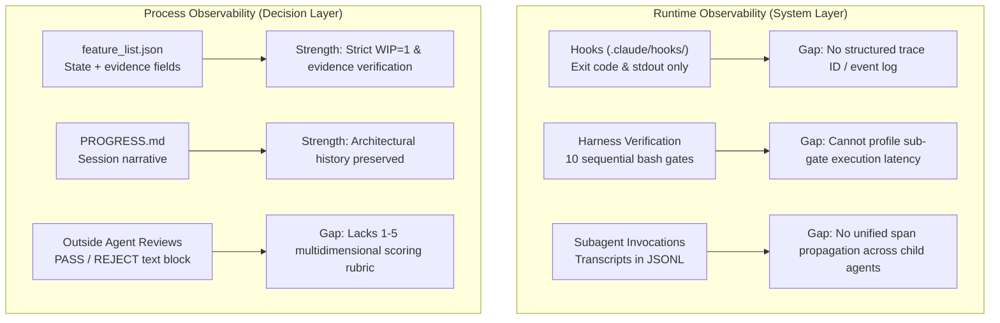

# Harness Creator Training — Lecture 11: Making the Agent's Runtime Observable

Source lecture: https://walkinglabs.github.io/learn-harness-engineering/en/lectures/lecture-11-why-observability-belongs-inside-the-harness/  
Target repo: `agent-skills-setup`  
Date: 2026-10-10. Full log: [progress-detail.md](./progress-detail.md). Code: [code/](./code/).

---

## 1. What the Lecture Claims

1. **The Real Cost of Missing Observability**:
   - **Cannot distinguish "correct" from "looks correct"**: Code review only inspects static syntax and structure, but runtime traces reveal whether boundary logic, data flow, or vector dimensions deviated from expectations.
   - **Evaluation becomes mysticism**: Without structured rubrics and verifiable acceptance criteria, evaluators (human or AI) fall back to subjective impressions ("doesn't feel right"), making quality scoring non-reproducible.
   - **Retries become blind wandering**: When an agent does not have precise error traces or context data, its retry direction is random, burning tokens and time fixing unrelated code paths.

2. **The Two Essential Layers of Observability**:
   - **Runtime Observability (System Layer)**: Emits structured signals — logs, traces, spans, correlation IDs, process events, health checks, resource consumption. Answers: *"What did the system actually do?"*
   - **Process Observability (Decision Layer)**: Emits structured decision artifacts — sprint contracts, evaluator rubrics, explicit exclusions, acceptance criteria. Answers: *"Why should this change be accepted?"*

3. **Why Agents Cannot Solve Observability Themselves**:
   - Agents don't know what they don't know; they only emit what they assume is relevant.
   - Unstructured `console.log` / `print` outputs vary across sessions and cannot be deterministically queried or parsed.
   - Process artifacts (sprint contracts, rubrics) require harness-level constraints and enforcement gates rather than inline conversational prompts.

4. **Anthropic 3-Role Harness (Opus 4.6 Benchmark)**:
   - Evaluated a Planner-Builder-Evaluator architecture across 3 development rounds (Total: 3 hr 50 min, $124.70).
   - Planner creates specifications ($0.46, 4.7 min); Builder implements; Evaluator tests the live running app and provides evidence-backed feedback (e.g. citing missing DAW knob interactions rather than vague dissatisfaction).
   - Early evaluators tended to excuse defects; fixing this required reading evaluator logs and refining prompts against human ground truth until scoring aligned.

---

## 2. What We Measured & Verified

| Exercise | Focus | Implementation & Findings |
|---|---|---|
| **1. Observability Gap Analysis** | System-layer & process-layer audit of `agent-skills-setup`. | Identified 4 critical blind spots in existing repo tooling: uncalibrated hook execution telemetry, silent tool denials by jetski, ambiguous gate failure attribution, and lack of quantitative grading rubrics for outside-agent reviews. |
| **2. Sprint Contract Practice** | Process observability via formal sprint contracts. | Scaffolded [`code/sprint-contract.md`](./code/sprint-contract.md) and [`code/evaluator-rubric.md`](./code/evaluator-rubric.md); evaluated contract-driven development vs unstructured prompting. Contracts eliminate scope creep, define explicit exclusions upfront, and convert subjective quality into 1–5 scoring. |
| **3. Task Trace Construction** | Machine-parseable structured logging & automated root-cause diagnosis. | Implemented [`code/runtime_logger.py`](./code/runtime_logger.py) and [`code/test_runtime_logger.py`](./code/test_runtime_logger.py) (13/13 tests pass, clean ruff/mypy). Diagnoses vector dimension mismatches, latency spikes (>1000ms), and cascading downstream failures in milliseconds vs minutes of manual log inspection. |

---

## 3. Analysis of Observability Layers (Exercise 1)

Our audit of `agent-skills-setup` revealed that while the repository has strong static guards (`state-layer-guard.sh`, `bash-compat-guard.sh`, `harness-verify.sh`), its runtime observability operates largely via unstructured stdout/stderr:



### Key Gaps Identified:
1. **Hook Telemetry Blind Spot**: If a hook fails, agents see standard error text, but there is no structured record capturing input parameters, environment variables, duration in milliseconds, or correlation IDs.
2. **Outside-Agent Evaluation Subjectivity**: Outside-agent reviews (`claude` / `agy`) rely on freeform Markdown verdicts. Without an explicit evaluator rubric (e.g. Grounding, Architectural Conformance, Test Completeness), review criteria vary between invocations.

---

## 4. Sprint Contract & Evaluator Rubric (Exercise 2)

We established two core harness artifacts in [`code/`](./code/):

### Sprint Contract ([`code/sprint-contract.md`](./code/sprint-contract.md))
```markdown
# Sprint Contract Example
Sprint goal: Add visible citations to grounded Q&A results
Done means:
- User asks a question
- App returns an answer
- At least one citation is shown
- Clicking a citation opens the source location in the document view
```

### Evaluator Rubric ([`code/evaluator-rubric.md`](./code/evaluator-rubric.md))
Transforms subjective evaluation into 1–5 evidence-based dimensions:
- **Grounding (1–5)**: Are generated outputs strictly anchored in verified sources?
- **Citation Quality (1–5)**: Are references granular, accurate, and verifiable?
- **Functionality (1–5)**: Does the workflow execute end-to-end without crashing?
- **Architectural Coherence (1–5)**: Does the change respect repository boundaries and patterns?

---

## 5. Structured Logger & Automated Diagnosis (Exercise 3)

In [`code/runtime_logger.py`](./code/runtime_logger.py), we simulated a 5-stage document Q&A pipeline (`DocumentLoader` $\to$ `ChunkIndexer` $\to$ `QueryRouter` $\to$ `RetrievalEngine` $\to$ `AnswerGenerator`) with a seeded vector dimension mismatch failure:

### Comparison: Ad-hoc vs Structured Logging
```
================================================================================
  SCENARIO A: Ad-hoc Unstructured Logs
--------------------------------------------------------------------------------
  Starting document Q&A pipeline...
  User uploaded quarterly_report.pdf
  DocumentLoader: parse_upload done (45ms)
  ChunkIndexer: embed_and_store done (230ms)
  QueryRouter: route_query done (12ms)
  RetrievalEngine: something went wrong
  AnswerGenerator: generate_with_citations done (1500ms)
  Pipeline finished. Answer: I could not find relevant information in the uploaded document.

  Diagnostic Verdict: Hard to tell what failed. 'something went wrong' lacks context.
================================================================================
  SCENARIO B: Structured JSON Logs with Trace Correlation
--------------------------------------------------------------------------------
| Status | Timestamp                    | Level  | Component          | Action                   | Duration   | Error                               |
|--------|------------------------------|--------|--------------------|--------------------------|------------|-------------------------------------|
| OK     | 2026-10-10T03:31:34+00:00    | INFO   | DocumentLoader     | parse_upload             | 45ms       |                                     |
| OK     | 2026-10-10T03:31:34+00:00    | INFO   | ChunkIndexer       | embed_and_store          | 230ms      |                                     |
| OK     | 2026-10-10T03:31:34+00:00    | INFO   | QueryRouter        | route_query              | 12ms       |                                     |
| ERROR  | 2026-10-10T03:31:34+00:00    | ERROR  | RetrievalEngine    | semantic_search          | 180ms      | Vector dimension mismatch: query em |
| OK     | 2026-10-10T03:31:34+00:00    | INFO   | AnswerGenerator    | generate_with_citations  | 1500ms     |                                     |
```

### Automated Diagnostic Output:
- **Root Cause**: `RetrievalEngine.semantic_search` — `Vector dimension mismatch: query embedding dim=768, index embedding dim=1536` (Span: `span-xxx`, Correlation ID: `req-xxx`).
- **Latency Spike**: `AnswerGenerator.generate_with_citations` took `1500ms` (threshold: `1000ms`).
- **Cascading Failure**: `AnswerGenerator` produced an empty answer with 0 citations due to receiving empty context (`[]`) from upstream retrieval failure.

### Performance Comparison Matrix:
| Metric | Ad-hoc Logs | Structured Logs |
|---|---|---|
| Root cause identifiable | No ("something went wrong") | **Yes** (Exact component, action, parameters, and error) |
| Input/output traceable | No | **Yes** (Input schema and output payload captured) |
| Step correlation (Trace ID) | No | **Yes** (`trace_id` and `correlation_id` propagated) |
| Machine parseable | No | **Yes** (Standardized JSON schema) |
| Time to diagnose | Minutes (manual log parsing) | **Milliseconds** (Automated query function) |

---

## 6. Key Takeaways for Harness Engineering

1. **Observability is an architectural invariant**: It cannot be retrofitted via conversational prompts. The harness must collect system signals automatically.
2. **Process observability aligns expectations before work begins**: Sprint contracts prevent agents from building plausible but misaligned solutions.
3. **Structured traces turn debugging into deterministic queries**: When every step emits structured context, root-cause analysis is immediate, eliminating trial-and-error retries.
