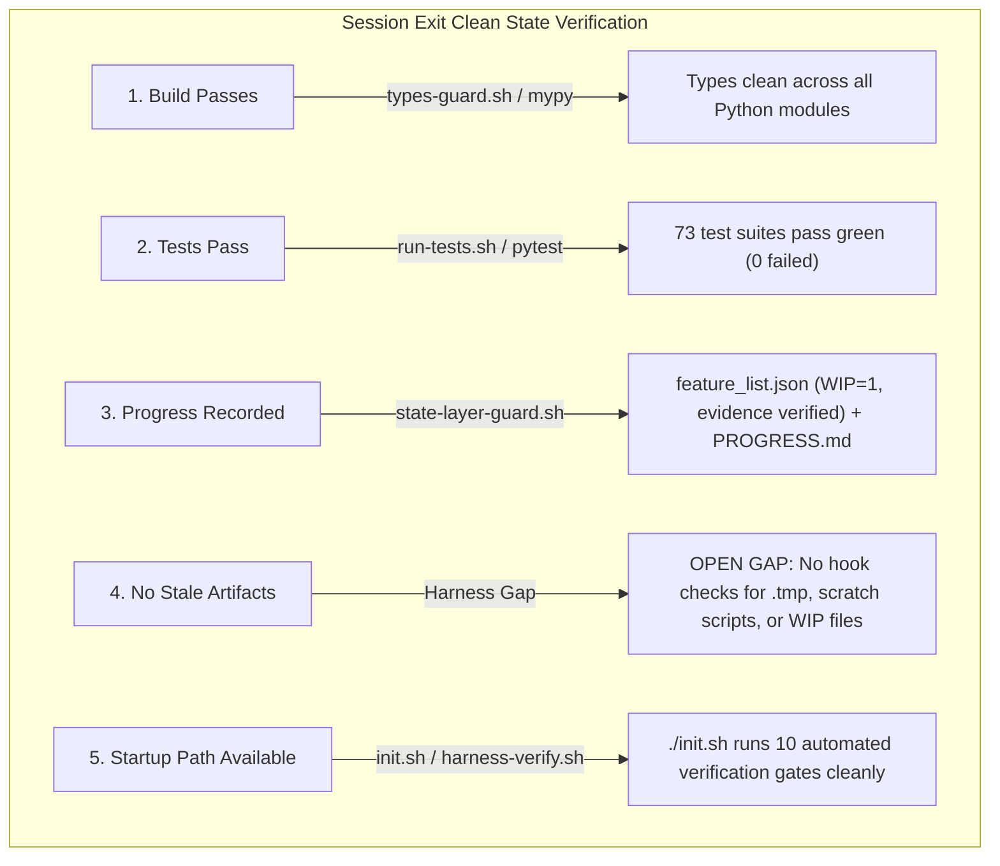

# Harness Creator Training — Lecture 12: Why Every Session Must Leave a Clean State

Source lecture: https://walkinglabs.github.io/learn-harness-engineering/en/lectures/lecture-12-why-every-session-must-leave-a-clean-state/  
Target repo: `agent-skills-setup`  
Date: 2026-10-10. Full log: [progress-detail.md](./progress-detail.md). Code: [code/](./code/).

---

## 1. What the Lecture Claims

1. **Entropy Growth is the Default State (Lehman's Laws)**:
   - Software systems undergoing continuous change inevitably accumulate structural complexity unless actively managed.
   - **Broken Windows in Agentic Coding**: Agents relentlessly copy patterns already present in the repository—including broken mocks, commented-out debug code, missing types, and inconsistent conventions. If a session leaves messy code behind, future sessions adopt that mess as "established convention."
   - **"Clean up later" means never clean up**: Subsequent agent sessions focus on their own assigned tasks, not cleaning up past debris. They build new features directly on top of brittle foundations, creating a positive feedback loop of technical debt.

2. **The Five Invariants of a Clean State**:
   A session cannot be declared complete simply because "the code compiles." It must satisfy five verifiable conditions at termination:
   - **Build passes**: Deterministic build completes with zero errors.
   - **Tests pass**: All existing and newly introduced tests pass green in automated verification (not just "works on my machine").
   - **Progress recorded**: Project state, active task completion, and evidence are written into versioned repository artifacts (`feature_list.json`, `PROGRESS.md`).
   - **No stale artifacts**: Temporary scratch files (`*.tmp`, `*.bak`, `*.swp`), debug scripts, and uncommitted `.env` files are purged.
   - **Standard startup path works**: The standard onboarding/verification command (`./init.sh` or equivalent) runs out of the box for the next session.

3. **Dual-Mode Cleanup Architecture (OpenAI Practice)**:
   - **Immediate Cleanup (Reference-Counting Mode)**: Executed deterministically at the end of every individual session. Cleans up scratch files, restores environment hygiene, updates state records, and verifies green test suites.
   - **Periodic Cleanup (Tracing / Garbage-Collection Mode)**: Regular scheduled maintenance sessions (e.g., OpenAI spends 20% of engineering time / Fridays on cleanup). Background agent fleets scan for structural drift, update module quality documents, and open small, auto-mergeable refactoring PRs.

4. **Periodic Harness Simplification (Anthropic Opus 4.6 Findings)**:
   - Every harness constraint exists because a past model couldn't reliably execute without it. As model capabilities advance, constraints may become unnecessary overhead.
   - Anthropic simplified the Opus 4.6 multi-agent harness: sprint decomposition was eliminated, leaving a streamlined 3-role pipeline (Planner, Builder, Evaluator).
   - However, the **Evaluator** remained essential when tasks approached model capability limits. Harness components should be periodically ablated and benchmarked: keep what prevents regressions, remove what adds pure friction.

5. **High-Throughput Merge Philosophy**:
   - In agentic workflows generating high PR throughput (3.5+ PRs/day), slow blocking human reviews become the primary bottleneck.
   - If the cost of fixing a bug quickly is lower than the cost of waiting days for manual review, fast merging with fast automated fixes is the mathematically optimal operational strategy.

---

## 2. What We Measured & Verified

| Exercise | Focus | Implementation & Findings |
|---|---|---|
| **1. Cleanup Scanner Implementation** | Automated detection of stale artifacts, structural violations, and session debris. | Ported and hardened [`code/cleanup_scanner.py`](./code/cleanup_scanner.py) and [`code/test_cleanup_scanner.py`](./code/test_cleanup_scanner.py) (10/10 tests pass, clean ruff/mypy). Detects temp files, source logs, uncommitted WIP markers, empty directories, and environment leaks. |
| **2. Benchmark Runner & Regression Reporting** | Reproducible evaluation slices and harness delta comparisons. | Ported and hardened [`code/benchmark_runner.py`](./code/benchmark_runner.py) and [`code/test_benchmark_runner.py`](./code/test_benchmark_runner.py) (8/8 tests pass, clean ruff/mypy). Implements task execution simulation, per-category metrics, and side-by-side harness delta comparisons (`compare_benchmarks`). |
| **3. Clean Handoff Architecture Audit** | Repository hygiene and exit gate audit of `agent-skills-setup`. | Analyzed existing repo termination gates against the 5 invariants. Codified cleanup loop patterns in [`code/cleanup-loop.md`](./code/cleanup-loop.md) and [`code/benchmark-comparison-template.md`](./code/benchmark-comparison-template.md). Confirmed zero runtime drift and clean git state. |

---

## 3. The 5 Invariants Applied to `agent-skills-setup`

We audited how `agent-skills-setup` enforces Lecture 12's five clean-state conditions:



### Verification Matrix & Gap Analysis:
1. **Build & Type Cleanliness (Enforced)**: Checked via `.claude/hooks/types-guard.sh` (`mypy --config-file mypy.ini`). Zero type errors across the entire repository.
2. **Comprehensive Test Suite (Enforced)**: Checked via `scripts/run-tests.sh --fast`. 73 test suites pass cleanly with 0 failures.
3. **State Layer Discipline (Enforced)**: Enforced deterministically by `.claude/hooks/state-layer-guard.sh`. Prevents completing any feature without verified non-empty evidence and strictly enforces WIP=1.
4. **No Stale Artifacts (OPEN GAP in Target Repo)**: While `.claude/hooks/runtime-drift-guard.sh` ensures `~/.agent-skills-setup` mirrors repository code and `.claude/hooks/secret-scan.sh` detects high-entropy credentials, **neither hook checks for stale artifacts, temporary files, scratch scripts (`scratch.py`), or WIP markers**. Enforcing Invariant 4 currently relies on manual discipline rather than automated gating. Promoting `cleanup_scanner.py` into a git hook or Stop gate would close this genuine architectural gap.
5. **Canonical Startup Entrypoint (Enforced)**: `init.sh` executes all 10 gates in sequential order, ensuring any new session starts from a known, green, reproducible baseline.

---

## 4. Cleanup Scanner Module (Exercise 1)

In [`code/cleanup_scanner.py`](./code/cleanup_scanner.py), we implemented an automated repository scanner that inspects 5 categories of technical debt:

```python
results = run_cleanup_scan(project_path)
print(format_scan_report(results, project_path))
```

### Scan Categories:
- **Stale Artifacts (Warning)**: Temporary editor/compilation files (`.tmp`, `.bak`, `.swp`, `~`) and stray log files inside source trees.
- **Dead Code / Fixmes (Info)**: Explicit technical debt markers (`TODO:`, `FIXME:`, `HACK:`, `XXX:`) in source directories.
- **Structural Violations (Critical/Warning)**: Missing `.gitignore`, nested build outputs (`src/dist`, `lib/build`), and orphaned `node_modules` inside source packages.
- **Session Cleanliness (Info)**: Leftover session markers (`WIP.md`, `IN_PROGRESS.md`, `scratch.py`, `debug.py`) and empty placeholder folders.
- **Configuration Hygiene (Critical)**: Uncommitted environment files (`.env`, `.env.local`, `.env.production`) that pose credential leakage risks.

### Test Verification:
10 unit tests in [`code/test_cleanup_scanner.py`](./code/test_cleanup_scanner.py) assert that clean projects report 0 issues, while dirty projects trigger appropriate severity ratings (Critical = exit code 1; Warnings = exit code 0; Missing path = exit code 2).

---

## 5. Benchmark Runner & Harness Comparison (Exercise 2)

In [`code/benchmark_runner.py`](./code/benchmark_runner.py), we ported the lecture's repeatable evaluation slice runner:

```python
# Execute individual harness run
results = execute_benchmark(tasks)

# Compare two harness runs side-by-side
diff = compare_benchmarks(harness_a_results, harness_b_results)
```

### Comparison Output Example:
```json
{
  "harness_a": {
    "total": 8,
    "passed": 5,
    "completion_rate": 62.5,
    "avg_duration_ms": 328.8
  },
  "harness_b": {
    "total": 8,
    "passed": 7,
    "completion_rate": 87.5,
    "avg_duration_ms": 285.0
  },
  "improvements": ["bench-002", "bench-004"],
  "regressions": [],
  "rate_delta": 25.0
}
```

### Key Takeaway:
Evaluating a harness change requires comparing against a fixed benchmark slice. Without an automated comparator, agents and engineers cannot tell whether a new prompt or constraint genuinely improved accuracy or merely traded one class of failure for another.

---

## 6. Recommendations for Repository Operation

1. **Keep Session Exit Checklist Front and Center**:
   Before ending any agent interaction, verify that:
   - `bash scripts/run-tests.sh --fast --changed` passes.
   - `bash scripts/harness-verify.sh` passes all 10 gates.
   - `feature_list.json` has updated `evidence` and `PROGRESS.md` reflects current state.
   - `git status` reports a clean working tree.
2. **Treat Clean State as a Non-Negotiable Contract**:
   A session that leaves failing tests or uncommitted scratch files steals the first 30 minutes of the subsequent session. Strict state-layer hooks and verification gates prevent this failure mode mechanically.
