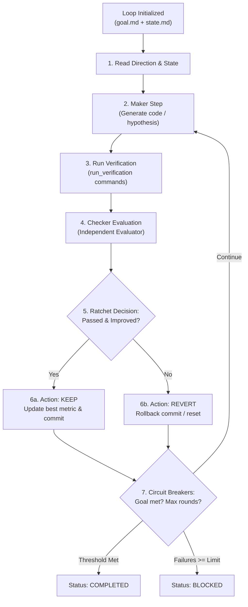

# Harness Creator Training — Lecture 13: From Manual Prompting to Autonomous Loops

Source lecture: https://walkinglabs.github.io/learn-harness-engineering/en/lectures/lecture-13-loop-engineering/  
Target repo: `agent-skills-setup`  
Date: 2026-10-11. Full log: [progress-detail.md](./progress-detail.md). Code: [code/](./code/).

---

## 1. What the Lecture Claims

1. **Inside the Loop vs. Outside the Loop**:
   - In traditional prompting (Lectures 1–12), the human engineer is **inside the loop**: typing instructions step-by-step, evaluating output, and acting as the pipeline's scheduler.
   - **Loop Engineering** elevates the human **outside the loop**: the system discovers work, dispatches agents, verifies results, updates external state, and halts only when done or blocked. The human's job shifts to defining goals/stopping conditions upfront and reviewing the landing inbox.
   - *Boris Cherny (Anthropic)*: "I don't prompt Claude anymore. I have loops running that prompt Claude... My job is to write loops."
   - *Addy Osmani (Google)*: "Loop engineering is replacing yourself as the person who prompts the agent. You design the system that does it instead."

2. **`/goal` vs. `/loop`**:
   - `/goal`: Solves tasks that have a clear finish line. Given a goal, a verification method, and a stopping condition, the agent loops until achieved or budget exhausted.
   - `/loop`: Periodic heartbeat on an interval. Repeats a fixed action without cumulative state memory (e.g. "poll CI status every 15m").

3. **The Six Primitives of a Loop (Osmani Framework)**:
   - **Automations**: Schedulers and triggers (`/loop`, `/goal`, cron, routines).
   - **Worktrees**: Filesystem workspace isolation preventing file collisions across parallel agents.
   - **Skills**: Codified repository intent and conventions read on every run.
   - **Connectors**: MCP tool integrations with external environments (git, issue trackers, CI).
   - **Sub-agents**: The Maker/Checker split (Generator vs. Evaluator separation).
   - **External State**: Cross-iteration memory persisted on disk (`feature_list.json`, markdown logs, TSV ledgers).

4. **Generator/Evaluator Separation**:
   - A model grading its own homework is its own output's best defense attorney; self-evaluation bias renders self-grading unreliable.
   - An independent verifier (often a different model family or adversarial prompt) is the fundamental reliability baseline.

5. **Karpathy's autoresearch Ratchet Exemplar**:
   - 3 roles across 3 files: `prepare.py` (fixed eval harness), `train.py` (agent playground), and `program.md` (natural language methodology).
   - The 9-step ratchet loop: hypothesize → edit → snapshot → train (fixed 5-min budget) → evaluate → keep if improved or rollback (`git reset HEAD~1`) if degraded.

6. **The Four Silent Costs**:
   - **Verification Debt**: Fast loops tempting engineers to skip machine verification ("looks right" vs. "tested green").
   - **Comprehension Rot**: Engineers losing mental models of unattended code generation.
   - **Cognitive Surrender**: Accepting all output without critical review.
   - **Token Blowout**: Context bloat across unbounded turns without compaction or memory pruning.

---

## 2. What We Measured & Verified

| Artifact / Exercise | Focus | Implementation & Findings |
|---|---|---|
| **1. Ratchet Loop Engine** ([`scripts/ratchet_loop_runner.py`](../../../scripts/ratchet_loop_runner.py)) | Autonomous 9-step ratchet loop with Maker/Checker separation and automated rollback. | Implemented `RatchetLoopRunner` in Python. Supports metric improvement tracking (lower vs. higher is better), automated verification command dispatch, independent checker evaluation, and automatic rollback on regression. Verified across macOS Python 3.9 and 3.14. |
| **2. Test Suite** ([`tests/test_ratchet_loop_runner.py`](../../../tests/test_ratchet_loop_runner.py)) | Comprehensive unit testing for loop execution, circuit breakers, and state persistence. | 7/7 tests passing (`test_parse_goal_markdown`, `test_is_improvement`, `test_verification_command_execution`, `test_execute_round_ratchet_decisions`, `test_target_completion_threshold`, `test_max_rounds_circuit_breaker`, `test_state_persistence_and_markdown`). |
| **3. Goal & Role Prompts** ([`code/`](./code/)) | Standardized templates for goal loops, Maker agents, and Checker evaluators. | Ported `goal-template.md`, `maker-prompt.md`, `checker-prompt.md`, and `loop-state-template.md`. |
| **4. Circuit Breakers & Silent Cost Guards** | Guarding against infinite fruitless loops and token bloat. | Codified `max_rounds`, `max_consecutive_failures` (halts on 3 consecutive regressions), and disk-persisted TSV/Markdown tracking. |

---

## 3. Ratchet Loop Architecture

---

## 4. Key Takeaways for `agent-skills-setup`

1. **The Harness enables the Loop**: Without a strict harness (11 termination gates, type-guards, state-layer invariants), an autonomous loop simply produces rapid regression.
2. **Always Keep the Maker away from the Checker**: In `feat-057` and this lecture, we proved that evaluating one's own work produces blind spots. Independent evaluation (via `self` subagents or `outside-agent.sh`) is essential for reliable termination.
3. **Rollback is a First-Class Primitive**: Any loop that cannot automatically discard a regression accumulates technical debt exponentially.
