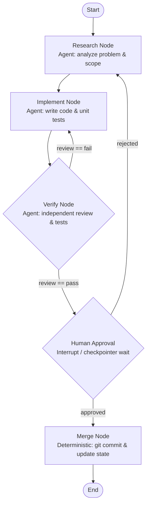

# Maker-Checker Graph Blueprint (Lecture 14)

> Blueprint specification of the decoupled Maker-Checker development graph.
> Demonstrates the four primitives: Nodes, Edges, Shared State, and Routing Rules.



---

## 1. Shared State Schema

At the graph level, only state is shared. Each agent node executes inside its own private context window and reads/writes the shared workspace.

```json
{
  "problem": "string",
  "requirements": "string",
  "code": "string",
  "test_results": "string",
  "review": "pass | fail | unclear",
  "attempts": 0,
  "human_approval": "pending | approved | rejected",
  "status": "RUNNING | PAUSED | COMPLETED | BLOCKED"
}
```

---

## 2. Node Table

| Node Name | Node Type | Internal Responsibility (Private Context) | State Read | State Written |
| :--- | :--- | :--- | :--- | :--- |
| **`research`** | Agent Node | Explore problem, inspect files, formulate requirements and handoff scope. | `problem`, `review` | `requirements` |
| **`implement`** | Agent Node | Write code and localized test cases against requirements. Self-loops on local syntax errors. | `requirements`, `problem` | `code`, `attempts` (+1) |
| **`verify`** | Agent Node | **Independent review with fresh context.** Executes tests and audits diff against invariants without implementer memory. | `code`, `requirements` | `review`, `test_results` |
| **`human_approval`** | Human / Pause Node | Checkpoint pause: writes state to disk and halts execution until human operator provides `approved` or `rejected`. | `code`, `review` | `human_approval` |
| **`merge`** | Deterministic Node | Commits changes locally, updates state layer, and generates telemetry. | `code`, `attempts` | `status = COMPLETED` |

---

## 3. Edge Table & Routing Rules

| Source Node | Edge Type | Condition / Expression | Target Node | Rationale |
| :--- | :--- | :--- | :--- | :--- |
| `START` | Direct Edge | Always | `research` | Graph entrypoint. |
| `research` | Direct Edge | Requirements generated | `implement` | Handoff from analysis to coding. |
| `implement` | Direct Edge | Implementation ready | `verify` | Handoff to independent checker. |
| `verify` | **Conditional Edge** | `state["review"] == "pass"` | `human_approval` | Verification passed; advance to gate. |
| `verify` | **Rollback Edge** | `state["review"] == "fail"` | `implement` | Verification failed; bounce back to code. |
| `human_approval` | **Conditional Edge** | `state["human_approval"] == "approved"` | `merge` | Human sign-off; proceed to commit. |
| `human_approval` | **Rollback Edge** | `state["human_approval"] == "rejected"` | `research` | Human rejects core premise; bounce back to research. |
| `merge` | Direct Edge | Commit succeeded | `END` | Terminal state. |

---

## 4. Key Architectural Insights

1. **Explicit Rollback:** In a single loop, "going back" is an implicit decision inside the model's head. In a graph, the rollback edge is visible, auditable, and instrumented.
2. **Context Freshness:** The `verify` node never inherits the transcript of `implement`. This eliminates confirmation bias and premature declaration of victory (Lecture 09).
3. **Interruptability:** The `human_approval` node persists state to disk via the checkpointer, enabling asynchronous human-in-the-loop validation without keeping LLM connections open (Lecture 12 & 14).
