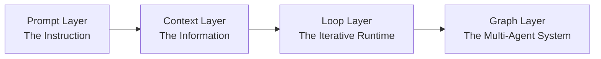

# Lecture 14. From Single Loops to Graph Engineering

> **Curriculum Alignment:** Lecture 14 of *Harness Engineering*
> **Focus:** Multi-agent Graph Engineering, DAG Workflows, State Machine Transitions, Checkpointing, and Rollback Routing.

---

## Executive Summary

While **Loop Engineering** (Lecture 13) focuses on making a single agent iterate until a goal is satisfied, **Graph Engineering** addresses the multi-agent system layer. When tasks grow to require specialization, parallelism, shared memory, independent verification, and explicit rollbacks, a single loop degrades into context bloat, Goodharting, and blindness. 

Graph Engineering organizes agents, tools, deterministic code, and human reviewers into an explicit graph of **Nodes, Edges, Shared State, and Routing Rules**.

---

## 1. The Four Stacked Layers: One Unified Architecture

As formulated by Rohit (@rohit4verse), Graph Engineering does not replace prior paradigms—it nests them:

| Layer | Focus | Core Question | Key Artifacts |
| :--- | :--- | :--- | :--- |
| **1. Prompt Engineering** | The instruction | *How do we tell the model what to do?* | System prompts, role definitions, JSON output constraints. |
| **2. Context Engineering** | The information | *What should the model know before deciding?* | RAG, tool definitions, file snapshots, transcripts. |
| **3. Loop Engineering** | The runtime | *How do we make the model iterate until done?* | Generator/Evaluator loop, Ratchet runner, stop conditions. |
| **4. Graph Engineering** | The system | *How do multiple agents, loops, and tools collaborate?* | Nodes, Edges, Shared State, Checkpointer, Routing Rules. |

> **Key Rule:** At the graph layer, **every node carries its own private prompt, context, tools, and loop**. The graph connects them, defining what each node sees and where execution flows.

---

## 2. Loop vs. Graph: The Up-Front Decision

| Dimension | Loop Engineering (Single Loop) | Graph Engineering (Multi-Node Graph) |
| :--- | :--- | :--- |
| **Decision Timing** | **Deferred Decision:** One agent handles everything; decisions happen implicitly inside context. | **Up-Front Decision:** Topology, node ownership, and failure paths are declared explicitly in advance. |
| **Failure Visibility** | Hidden inside agent context window; agent struggles silently or loops endlessly. | Visible on paper; each edge failure points directly to the failing subsystem. |
| **Context Scope** | Monolithic; transcript inflates and degrades reasoning accuracy. | Isolated; each node receives only the slice of shared state it requires. |
| **Best Suited For** | Fast exploratory spikes, local code editing, single-objective tasks. | Production pipelines, multi-agent teams, mission-critical verification. |

---

## 3. Three Structural Failures of a Single Loop at Scale

Why do single loops fail when scaled? *Graph Engineering for AI Agents* (eigent.ai) identifies three fundamental structural defects:

1. **Goodhart's Law (Metric Divergence):**
   - *Failure:* A loop optimizes its metric at the expense of business intent (e.g., closing support tickets by deflecting users rather than fixing bugs).
   - *Graph Solution:* Decoupled Evaluator and Veto nodes with differing objectives prevent one metric from hijacking system goals.
2. **Blindness Upward (Sacred Target Trap):**
   - *Failure:* A single loop cannot ask "Is this target actually sane?" It blindly drives toward a misguided goal.
   - *Graph Solution:* Hierarchical supervisor/orchestrator nodes that can alter or abort sub-goals based on global state.
3. **Loop Conflict (Uncoordinated Thrashing):**
   - *Failure:* An optimization loop for speed conflicts with an optimization loop for thoroughness.
   - *Graph Solution:* Explicit edge synchronization and fan-in merge rules that arbitrate trade-offs.

---

## 4. Graph vs. Workflow: The Critical Distinction

A common industry misconception is that "graphs are just workflows renamed." 

- **Workflow (Deterministic):** Nodes are deterministic functions (scripts, SQL queries). Edges are hardcoded conditional branches (`if/else`). Predictable and repeatable.
- **Agent (Stochastic):** The model dictates control flow dynamically at runtime based on its own reasoning.
- **Graph (Generalization):** The umbrella architecture that holds **both**:
  - Deterministic nodes (e.g., run `git commit`, execute `pytest`).
  - Agent nodes (e.g., research root cause, write implementation).
  - Human nodes (e.g., human-in-the-loop sign-off).

---

## 5. Cold Water: The Orchestration Tax

As observed by Addy Osmani (*The Orchestration Tax*):
> *"Starting an agent is cheap. Closing the loop on one is expensive. You are the GIL of your AI agents. They can all run at once, but when their work needs architectural understanding or merge conflict resolution, that work must acquire the single serial lock: you."*

Adding more agent nodes in parallel does not parallelize human judgment. Graph design must minimize human attention spend by ensuring deterministic nodes and automated checkers filter out noise before escalating to human review.

---

## 6. The 5 Criteria: When You Actually Need a Graph

Do not build a graph for simple sequential scripts. A task requires a graph if it meets at least **3 of the 5 criteria**:

1. **Independent Decomposability:** The task breaks into units that can execute in parallel without shared locks.
2. **Explicit Rollback Paths:** Failures do not restart from zero; they return specifically to the node that produced the defect.
3. **Durable Checkpointing:** Intermediate state is valuable and can be paused/resumed across process restarts.
4. **Machine-Verifiable Outcomes:** Every node has an automated, deterministic definition of done.
5. **Coordination Benefit > Orchestration Overhead:** Time saved by specialization and parallelism exceeds the cost of graph state management.
