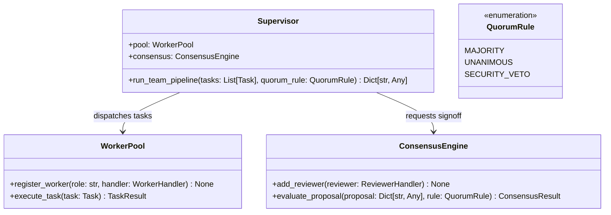

# System Blueprint: Multi-Agent Team Topology & Consensus Engine

## Architecture Specification

This document defines the interface and data contracts for the zero-dependency Multi-Agent Team Engine (`scripts/team_runner.py`).

---

## 1. Core Classes & Roles

---

## 2. Data Models (JSON Serializable)

### `Task`
- `task_id`: `str` — Unique task identifier.
- `role_required`: `str` — Required worker specialty (`researcher`, `coder`, `tester`, `reviewer`).
- `prompt`: `str` — Isolated prompt containing task goal and input parameters.
- `timeout_sec`: `float` — Maximum execution budget.

### `TaskResult`
- `task_id`: `str`
- `status`: `str` — `completed`, `failed`, or `timeout`.
- `output`: `Dict[str, Any]` — Structured return payload.
- `error`: `Optional[str]`
- `duration_ms`: `float`

### `Vote`
- `reviewer_id`: `str`
- `role`: `str`
- `decision`: `str` — `APPROVE`, `REJECT`, or `ABSTAIN`.
- `confidence`: `float` (0.0 to 1.0)
- `rationale`: `str`
- `has_veto_power`: `bool`

### `ConsensusResult`
- `verdict`: `str` — `ACCEPTED`, `REJECTED`, or `NO_QUORUM`.
- `quorum_rule`: `str`
- `approve_count`: `int`
- `reject_count`: `int`
- `abstain_count`: `int`
- `total_votes`: `int`
- `vetoed`: `bool`
- `veto_by`: `Optional[str]`
- `votes`: `List[Vote]`

---

## 3. Quorum Resolution Invariants

1. **SECURITY_VETO Rule:**
   - If any reviewer with `has_veto_power=True` casts `decision="REJECT"`, the proposal is **immediately REJECTED**, regardless of approval count.
2. **MAJORITY Rule:**
   - Proposal is `ACCEPTED` if `approve_count > total_valid_votes / 2`.
3. **UNANIMOUS Rule:**
   - Proposal is `ACCEPTED` if and only if `approve_count == total_reviewers` and `reject_count == 0`.
