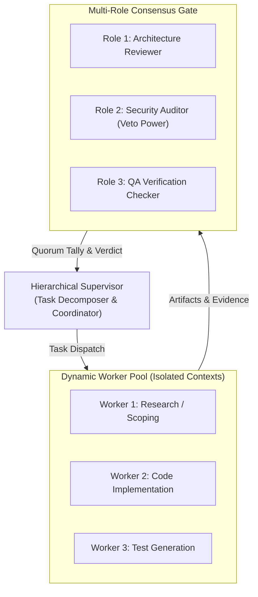

# Lecture 15. Multi-Agent Team Topologies & Consensus Orchestration

> **Curriculum Alignment:** Lecture 15 of *Harness Engineering* (Advanced Systems Track)
> **Focus:** Hierarchical Supervisors, Dynamic Worker Pools, Context Isolation, and Multi-Role Consensus Voting.

---

## Executive Summary

While **Graph Engineering** (Lecture 14) formalizes explicit nodes and edges, real-world frontier systems must orchestrate **multiple autonomous agents** working concurrently without falling into the traps of quadratic context bloat, groupthink, or uncoordinated state thrashing.

Lecture 15 explores how to construct resilient **Multi-Agent Team Topologies** and **Consensus Engines**. Instead of allowing multiple agents to enter an unconstrained group chat, production harnesses enforce strict organizational structures: **Hierarchical Supervisors**, **Dynamic Worker Pools**, **Private Scratchpads**, and **Deterministic Quorum Gates**.

---

## 1. The Four Team Topologies

Not all multi-agent tasks require the same structure. Modern agent engineering classifies teams into four foundational topologies:

| Topology | Communication Pattern | Coordination Tax | Best Suited For | Failure Mode If Misapplied |
| :--- | :--- | :--- | :--- | :--- |
| **1. Pipeline / Assembly Line** | Sequential $A \to B \to C$ | Low ($O(N)$) | Well-defined, predictable stages (e.g. Intake → Code → Review). | Single point of failure; upstream errors amplify downstream. |
| **2. Hub-and-Spoke (Supervisor)** | Star pattern; all communication routes through Supervisor | Medium ($O(N)$) | Complex task decomposition, dynamic delegation, resource allocation. | Supervisor context bottleneck if workers return verbose transcripts. |
| **3. Independent Evaluator (Maker-Checker)** | 2 agents: Generator proposes, Evaluator vetoes/approves | Low ($O(1)$) | Quality gating, verification before completion, pull request reviews. | Gridlock if Evaluator criteria are overly pedantic or subjective. |
| **4. Consensus Council (Quorum)** | Multiple distinct evaluator roles vote on proposals | Controlled ($O(M)$) | High-stakes decisions: production deployments, schema migrations, security signoff. | Deadlock when consensus rules require unachievable unanimity. |

> [!CAUTION]
> **The Group Chat Anti-Pattern ($O(N^2)$ Complexity):**
> Allowing $N$ agents to chat freely in a shared channel results in quadratic token growth, cognitive dilution, sycophancy, and hallucination cascading. Frontier harnesses strictly forbid unstructured group chats in production pipelines.

---

## 2. Dynamic Worker Pools & Context Isolation

When a supervisor dispatches work to subagents, the primary hazard is **Context Dilution**. If a subagent inherits the full transcript of the supervisor, token costs explode and attention to instructions drops precipitously.

### Core Principles of Dynamic Worker Pools:
1. **Fresh Context per Task:** Each worker spins up in a clean subagent session with only the scoped task prompt and minimal required artifacts.
2. **Blast Radius Containment:** A worker's tool capabilities are restricted (e.g. read-only tools for researchers; sandboxed write tools for coders).
3. **Structured Returns (The Artifact Handoff):** Workers must return structured JSON summary blocks containing machine-verifiable artifacts, not narrative rambling.

---

## 3. Multi-Role Consensus Voting Engine

Single-checker setups suffer from **evaluator bias**—a checker may overlook subtle security vulnerabilities while hyper-focusing on test formatting.

A **Consensus Council** addresses this by querying multiple orthogonal roles:
- **Role A (Domain Architect):** Checks functional correctness, design patterns, and interface compatibility.
- **Role B (Security Auditor):** Audits permission boundaries, secret exposure, input sanitation, and denial-of-service vectors. **Holds VETO power.**
- **Role C (QA / Test Verification):** Asserts deterministic test execution, boundary condition coverage, and negative test cases.

### Consensus Quorum Rules:
1. **Majority Quorum (>50%):** Standard decisions where non-critical disagreements can be overridden.
2. **Unanimous Quorum (100%):** Critical state changes (e.g. deleting production records, altering root credentials).
3. **Veto Quorum (Weighted Veto):** A proposal passes if majority approves **AND** no designated VETO role (such as Security) rejects it.

---

## 4. Key Takeaways for Harness Engineering

1. **Hierarchy Prevents Chaos:** Tasks beyond a single prompt require a supervisor to own the overarching state machine while delegating sub-goals.
2. **Isolate Context Deliberately:** Never pass full transcripts to workers; pass task contracts.
3. **Consensus Outweighs Individual Calibration:** When automated verification cannot be fully unit-tested (e.g. architectural sanity or security posture), multi-role consensus with veto gates prevents catastrophic agent drift.
