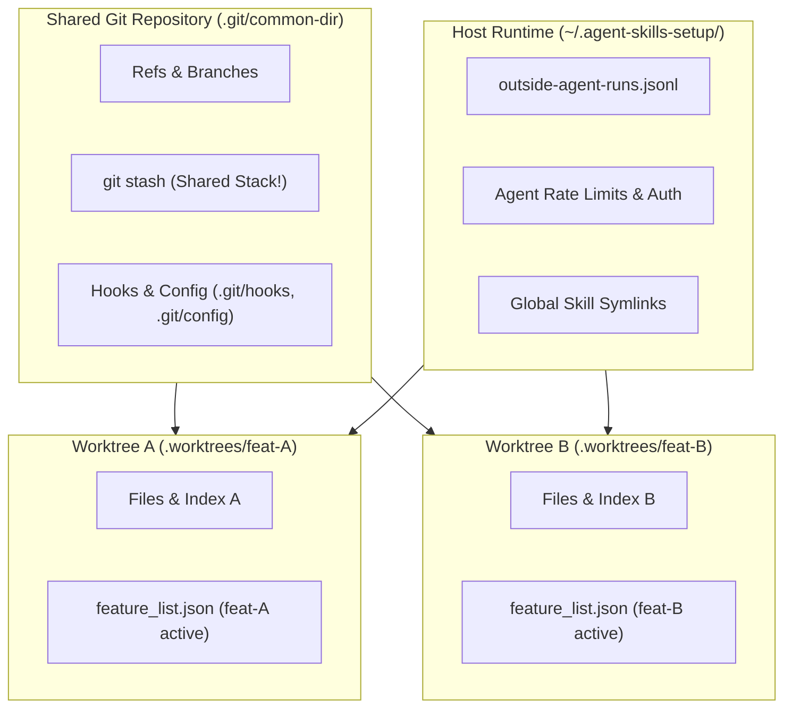

# Multi-Session & Git Worktree Handoff Guide

This document defines the risks, shared state boundaries, and handoff protocols when running multiple agent sessions in the same repository—both sequentially and concurrently via Git worktrees.

---

## 1. Core Principle: Filesystem Isolation ≠ State Isolation

Git worktrees provide **filesystem isolation** (independent working directories, distinct staging indexes, and separate `HEAD` branch pointers). However, they **do not provide complete process, repository, or state-layer isolation**.

When multiple autonomous agent sessions run in parallel across worktrees or sequentially across turns, they can collide or misunderstand each other across five distinct architectural layers.



---

## 2. Shared State Collision Vectors

### 2.1 Git Internal Mechanics (Shared `.git`)
- **`git stash` is completely shared:** The stash reflog (`.git/refs/stash`) is global to all worktrees. If Session A stashes changes and Session B runs `git stash pop`, Session B pops Session A's uncommitted work into its own working tree.
- **`.git/hooks/` and repository config:** Any modification to Git hooks, git configuration, or attributes immediately applies to all active worktrees.
- **Branch Checkouts:** Git prevents checking out the exact same branch name across multiple worktrees simultaneously (`fatal: '<branch>' is already checked out`).
- **Git Locks:** Reflock creation (`.git/refs/heads/*.lock`) during concurrent commits or background `git gc` can cause transient race condition failures.

### 2.2 State Layer & Telemetry Interference
- **`feature_list.json` WIP Invariant:** The harness enforces `WIP <= 1`. While both worktrees satisfy `WIP=1` locally on their respective branches, merging both branches into `main` creates a merge conflict on the features array. Blindly resolving it can drop completed feature metadata or violate `WIP=0/1` invariants.
- **`PROGRESS.md` Context Blindness:** Fresh agents inspect `PROGRESS.md` at turn 1. A worktree branched before an adjacent session commits will remain blind to newly completed features on `main` unless explicitly rebased.
- **Telemetry Divergence (`docs/telemetry/`):** Both worktrees append snapshot lines to `evaluation-trace.jsonl`. Concurrent appends produce merge conflicts at EOF and non-monotonic timestamp histories.

### 2.3 Host Runtime & Symlink Poisoning
- **`install.sh` Symlinks (Codified in `require_main_checkout`):** Running `install.sh` from a linked worktree points host-level agent symlinks (`~/.claude/skills/`, etc.) at the transient worktree directory. When the worktree is deleted after feature completion, every skill symlink on the host dangles and breaks.
- **Runtime Drift Guard (`Gate 10`):** If Session A syncs updated runtime scripts (e.g. `outside_agent.py`) to `~/.agent-skills-setup/`, Session B's older worktree commit will immediately fail Gate 10 in `scripts/harness-verify.sh`.
- **Global Rate Limits:** API quota states in `~/.agent-skills-setup/outside-agents.json` are shared per host.

### 2.4 Build & Test Collisions
- **Virtual Environments & Caches:** Sharing a single `.venv`, `.pytest_cache`, or `.mypy_cache` during parallel test runs can result in file lock contention or stale bytecode execution.
- **Static Ports:** Mock HTTP servers, test databases, or Playwright browser instances bound to hardcoded ports collide if executed in parallel.

---

## 3. The Two Handoff Protocols

### Protocol A: Single-Run Handoff (Sequential Sessions)

Used when agents run one after another on `main` with fresh context windows.

#### Outgoing Agent Checklist (Session Close)
1. **State Layer:**
   - In `feature_list.json`: Mark active feature `completed` and supply verifiable `evidence`.
   - In `PROGRESS.md`: Move feature to `What's Done`, set `What's In Progress` to none, and update `What's Next`.
2. **Clean State & Telemetry:**
   - Execute `bash scripts/session-clean.sh` (cleans caches, syncs runtime copies, verifies 5 clean-state invariants).
   - Execute `bash scripts/trace-evaluation.sh` to record execution telemetry.
3. **Commit Cleanly:**
   - Verify `git status` has zero untracked or unstaged files.
   - Commit locally: `feat(scope): concise description (feat-XXX)`.

#### Incoming Agent Checklist (Session Start)
1. Read `AGENTS.md` completely.
2. Read `feature_list.json` and `PROGRESS.md` for current state and next priorities.
3. Run `./init.sh` to confirm all 11 gates are green before touching any code.
4. Select the top item from `What's Next` and set status to `in_progress` (`WIP=1`).

---

### Protocol B: Parallel Sessions Handoff (Concurrent Worktrees)

Used when multiple independent tasks run simultaneously in separate worktrees.

```
                    ┌── Worktree A (feat-A) ──> Commit A ──┐
main (clean baseline) ──┤                                          ├──> Serialized Rebase onto main
                    └── Worktree B (feat-B) ──> Commit B ──┘
```

#### Parallel Session Operating Rules
1. **Task Orthogonality:** Only dispatch parallel worktrees for disjoint sub-trees (e.g. documentation vs. separate skill modules).
2. **Never Stash:** Use explicit checkpoint commits (`git commit -m "wip: ..."`) instead of `git stash`.
3. **Never Install Runtime from Worktree:** Do not execute `install.sh` or `install_runtime_dir` inside a secondary worktree.

#### Convergence & Merge Gate (Serialized Landing)
When worktree tasks complete:
1. **First Worktree Lands:**
   - Merges cleanly into `main`.
   - Runs `bash scripts/harness-verify.sh` and `scripts/session-clean.sh`.
   - Removes worktree: `git worktree remove .worktrees/feat-A`.
2. **Second Worktree Lands (Mandatory Rebase):**
   - The second worktree must rebase onto the newly updated `main`:
     ```bash
     git fetch origin
     git rebase main
     ```
   - **Resolve State Layer:**
     - In `feature_list.json`: Merge both features into the completed list; maintain valid JSON syntax and `WIP <= 1`.
     - In `PROGRESS.md`: Concatenate completion summaries under `What's Done`.
   - **Full Verification:** Run `bash scripts/harness-verify.sh` on the rebased tree.
   - Fast-forward merge into `main` and remove worktree: `git worktree remove .worktrees/feat-B`.

---

## 4. Handing Off Incomplete Tasks (The "Red-to-Green Baton Pass")

If a session must terminate before completing a feature (turn exhaustion, rate limit, context boundary):

1. **Write a Reproducible Failing Test (Karpathy Rule 4):**
   - Create or update a test that fails cleanly asserting the target behavior.
2. **Make a Checkpoint Commit (No Untracked Files):**
   ```bash
   git commit -m "wip: failing test asserting edge-case behavior (feat-XXX)"
   ```
3. **Leave an Actionable Handover in `PROGRESS.md`:**
   ```markdown
   ### What's In Progress
   - [ ] feat-XXX: Incomplete handoff.
     - Done: Implemented baseline parser in `scripts/foo.py`.
     - Failing: `pytest tests/test_foo.py -k test_edge_case` (fails with KeyError: 'id').
     - Next Action: Add null check on line 42 of `scripts/foo.py`.
   ```
4. **The Incoming Session Picks Up Instantly:**
   - Runs the reproduction command (`pytest tests/test_foo.py -k test_edge_case`), observes the red failure, and begins development without ambiguity.
